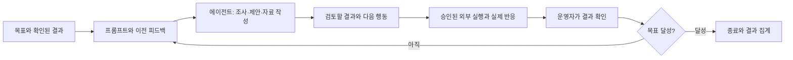

# GTM Agentic Loop

고객의 실제 업무를 이해하고, 작은 제안을 실행한 뒤, 반응에 따라 다음 행동을 바꾸는 7일 GTM 실험입니다. B2B 업무 소프트웨어를 대상으로 한 방법론만 공개합니다. 회사 소개, 고객 사례 원문, 연락처, 실제 운영 데이터는 포함하지 않습니다.

## 무엇이 반복되는가



`scripts/loop.py run`은 매 반복마다 Codex CLI를 실제 호출합니다. 고정된 작업 목록을 매일 재생하지 않고, 목표와 현재 결과의 차이, 관측, 이전 실행을 프롬프트에 넣어 다음 행동을 결정합니다. 전략 변경과 작업 결과는 다음 반복에 전달됩니다. 목표 달성 시 종료하고, 승인·응답 대기 중에는 입력이 바뀔 때까지 모델을 다시 호출하지 않습니다. 기한, 호출 한도, 오류, 운영자 중지는 성공과 구분합니다.

이 제출본은 로컬 실행기와 실행 지침입니다. 상시 프로세스를 설치하거나 실제 고객에게 연락한 상태는 아닙니다. 모델은 외부 성과를 스스로 확정할 수 없습니다.

## 빠르게 확인하기

Python 3.10 이상만 필요합니다. 합성 데모와 테스트에는 모델 호출이나 인증이 필요 없습니다.

```sh
python3 scripts/loop.py demo --runtime ../gtm-loop-demo
python3 -m unittest discover -s tests -v
python3 scripts/check_submission.py
```

합성 데모는 거절 피드백 → 제안 수정 → 합성 목표 달성을 여러 반복으로 보여줍니다. 실제 LLM 동작이나 고객 성과를 입증하는 자료가 아닙니다.

실제 실행에는 별도로 로그인한 Codex CLI가 필요합니다. [실행 방법](docs/RUNNING.md)에 따라 제출 폴더 밖의 운영 공간을 초기화하고, 그곳에만 제품·대상·관측을 작성합니다.

```sh
python3 scripts/loop.py init --runtime ../gtm-loop-private
python3 scripts/loop.py run --runtime ../gtm-loop-private
```

첫 명령은 빈 운영 공간을 만듭니다. 두 번째 명령은 설정된 모델을 호출하며, 목표/기한/한도까지 반복합니다. `Ctrl+C` 후 같은 명령으로 이어서 실행할 수 있습니다. 운영 데이터가 없으면 이를 요청하고 대기합니다.

## 제출에서 볼 것

| 항목 | 위치 |
| --- | --- |
| 7일 목표와 평가 기준 | [SUBMISSION.md](SUBMISSION.md) |
| 고객·제품에 맞게 루프를 선택하는 기준 | [docs/LOOP.md](docs/LOOP.md) |
| 측정·성과 판정 | [docs/MEASUREMENT.md](docs/MEASUREMENT.md) |
| 실제 반복 실행·재개 | [docs/RUNNING.md](docs/RUNNING.md) |
| 에이전트 프롬프트 | [prompts/iteration.md](prompts/iteration.md) |
| 재사용 실행 지침 | [skills/gtm-loop/SKILL.md](skills/gtm-loop/SKILL.md) |
| 제출 정보와 운영 정보의 경계 | [docs/DATA-BOUNDARY.md](docs/DATA-BOUNDARY.md) |
| 합성 실행 기록 | [examples/synthetic-cycle.json](examples/synthetic-cycle.json) |

실제 수치의 시작 기준값은 운영 시 고정합니다. 이 저장소의 예시와 목표를 실제 실적에 합산하지 않습니다.

검증: 자동 테스트 12개, 합성 3회 반복의 피드백 전달·목표 종료, 실제 Codex CLI 1회 호출과 JSON 응답 수신을 확인했습니다. 실제 호출 확인은 합성 입력만 사용했고 호출 한도에서 종료했습니다. 고객 대상 운영이나 성과를 뜻하지 않습니다.
